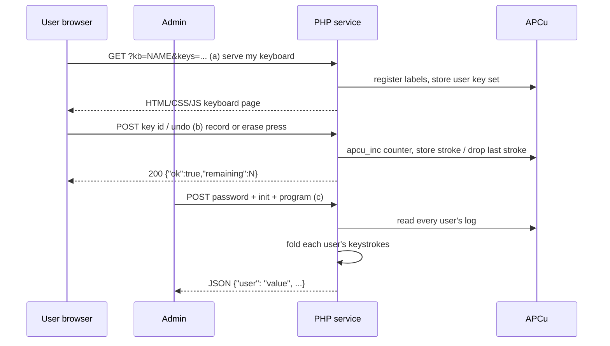

# Virtual Key Device — Overview

**Status:** Draft · **Normative language:** the key words MUST, MUST NOT, SHOULD, and MAY are to be interpreted as in RFC 2119.

This document is the corpus entry point: purpose and scope, system overview, concepts, shared invariants, and the summary table of constants. Application behavior lives in the functional documents (01, 02); infrastructure contracts in the technical documents (03, 04).

## 1. Corpus

| Document | Nature | Content |
|---|---|---|
| [00 — Overview](00-overview.md) | framing | purpose and scope, concepts, shared invariants, constants |
| [01 — The keyboard](01-keyboard.md) | functional | endpoint (a) keyboard page, endpoint (b) keystroke capture, key id attribution |
| [02 — The probe](02-probe.md) | functional | probe language, endpoint (c) admin aggregation, reset, test vectors |
| [03 — Storage (APCu)](03-storage.md) | technical | storage schema, TTLs, user enumeration, memory bounds |
| [04 — Security](04-security.md) | technical | hardened sessions, XSS, admin password, language boundary |
| [05 — Aliases](05-alias.md) | functional | alias concept, alias entry (a), rerouting at (b), alias management (d) |

## 2. Purpose and scope

A web-based virtual device with up to 25 labeled keys. Multiple anonymous users press keys; every press is recorded per user. An administrator queries aggregate results by submitting an initial value and a **folding function** written in a closed expression language (the *probe language*). The server folds each user's keystroke history into a single value and returns one result per user.

Core principle: **capture is interpretation-free**. The system records only key identities at press time; all semantics live in the probe program submitted at query time. New interpretations of the same history require no change to capture or storage.

Capture offers two modes, and the mode is a property of the **device**: **main** (a plain keyboard page with no on-device feedback — typical use: continuous activity such as a game, whose feedback lives on another display) and **limited** (each user gets a small stroke budget `L` with `0 < L ≤ MAX_STROKES`; their whole keystroke history on the device is permanently displayed and the last keystroke can be erased — typical use: entering a choice in answer to a question). A device name is used in exactly one mode, fixed at first load. Both modes record into the same per-user log; the mode constrains capture and feedback only — never interpretation.

The administrator may also publish **aliases**: stable public names bound to device definitions, so that users follow a single URL through a sequence of devices without any manual re-initialization; a rebound alias carries its users to the new target at their next keystroke (*Aliases*).

In scope: a single PHP server using APCu shared-memory storage, anonymous users (one browser session each), one admin.

Out of scope (non-goals): persistence across server restarts, user authentication, horizontal scaling, real-time push to clients.

## 3. System overview

The PHP entry point serves four URLs over one APCu store:

- **(a)** `GET` with a device name and a keyboard definition — or with an alias name resolved to the same definition (*Aliases*) — `limit=L` declares the device limited → HTML/CSS/JS page rendering that keyboard; in limited mode the page also permanently shows the user's whole confirmed keystroke history and an erase control.
- **(b)** `POST` of a key id — or, in limited mode, of an undo command → append the keystroke to, or erase the last keystroke of, that user's log; a keystroke from a user whose alias has been retargeted is not recorded and triggers rerouting (*Aliases*).
- **(c)** `POST` of admin password + init + probe program → JSON map of user → folded value.
- **(d)** `POST` of admin password + an alias action (`alias` upsert / `alias-del`) → JSON `{"ok": true}` (*Aliases*).

Key properties:

- **Users are independent.** Results are computed per user; there is no cross-user ordering and no global combined result.
- **The probe language is closed** (non-Turing-complete): no loops, no recursion, no I/O. A submitted program is data, not code; its evaluation cost is statically bounded.
- **All state is in APCu**, including the label registry; everything expires or wipes together, so identifiers are never reassigned under live data.

## 4. Concepts

| Concept | Definition |
|---|---|
| Device | A named instance (the `kb` request parameter) owning its own keyboards, user logs, and label registry. The unit of isolation and reset. |
| Keyboard | A grid of cells; each cell is *active* (has a label) or *inactive*. |
| Label | A non-comma string naming a key. Must be unique among the active keys of a keyboard. |
| Key id | A non-negative integer assigned to a label by the global label registry, in first-seen order. |
| Keystroke | One key id, recorded at an integer index in the pressing user's log. |
| Device mode | Whether a device is main or limited; recorded by the first (a) served on it (presence of `limit`), stored device-wide, never changed afterwards — a different run uses a fresh device name. |
| User | An anonymous browser session; the user id `uid` is the PHP session id. |
| Probe | A pair *(init, program)*: an integer initial value plus one pure expression over `v` (state) and `k` (key id). |
| Alias | A stable public name bound by the admin to a device definition; resolved at (a), rerouting its users at (b) when retargeted (*Aliases*). |

## 5. Shared invariants

Both invariants are normative and bind the whole corpus.

**Label-based key identity.** Key ids are content-addressed (by label), never position-derived. They are assigned per device, in first-seen order, and remain stable for as long as the device's keystroke logs live. Intended consequences:

- Reordering keys, changing the grid size, or moving inactive cells around affects neither the ids nor existing probes.
- Renaming a label referenced by a probe fails loudly at request parse time (`422 unknown label`), never silently.
- Two keyboards of the same device that share a label share its id; a device's probe vocabulary is the set of labels ever served on that device, not any single keyboard's layout. Devices have fully independent id spaces.

Id attribution is specified in *The keyboard*, resolution at query time in *The probe*, and the registry's storage rules in *Storage (APCu)*.

**Per-device namespaces.** All stored data is namespaced under the device name. Two devices never interact; a fresh device name means fresh storage with no reset step; the admin `reset` action wipes an entire namespace. (Storage keys: *Storage (APCu)*.)

## 6. Constants (summary)

The normative value of each constant lives in the document that applies it; this table is the global point of agreement. Any change to a value happens here **and** in the document concerned.

| Constant | Value | Applied in |
|---|---|---|
| `MAX_STROKES` | 300 | *The keyboard* — keystroke cap per user per device |
| `MAX_PROGRAM_SIZE` | 2048 | *The probe* — max probe program size (chars) |
| `MAX_STATE_BITS` | 4096 | *The probe* — max state width per fold step |
| `KB_TTL` | 3600 | *The keyboard* / *Storage (APCu)* — per-user data lifetime (seconds) |
| `KEYBOARD_SIZES` | 9 admitted capacities | *The keyboard* — geometry (normative table) |
| `KB_NAME_RE` | `/^[A-Za-z0-9_-]{1,32}$/` | *The keyboard* — device name pattern |
| `ADMIN_HASH` | SHA-256 hex of the admin password | *The probe* — admin authentication |
